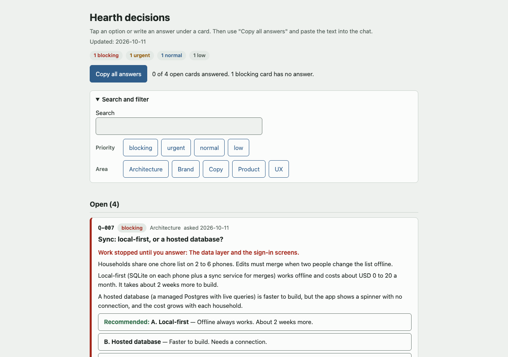
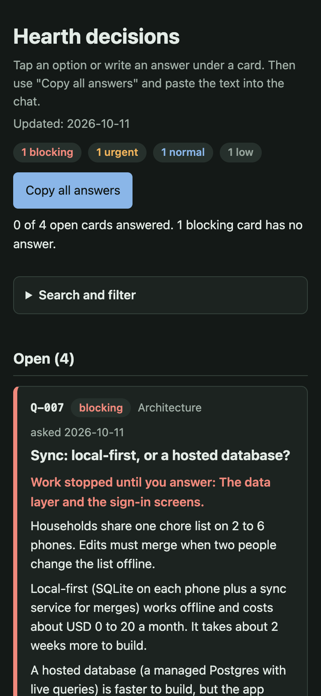
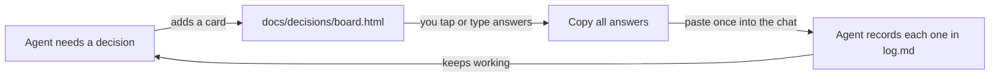
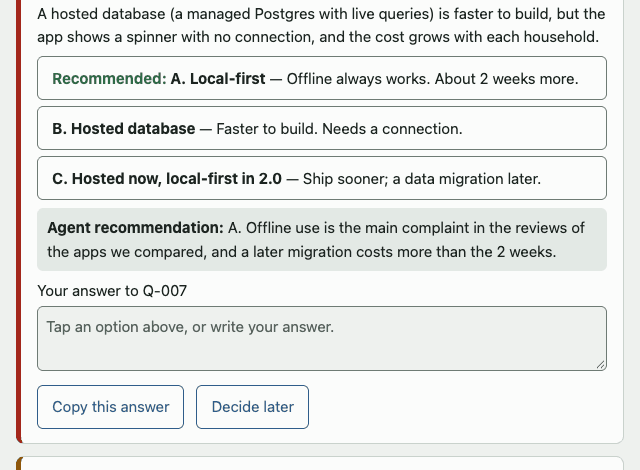
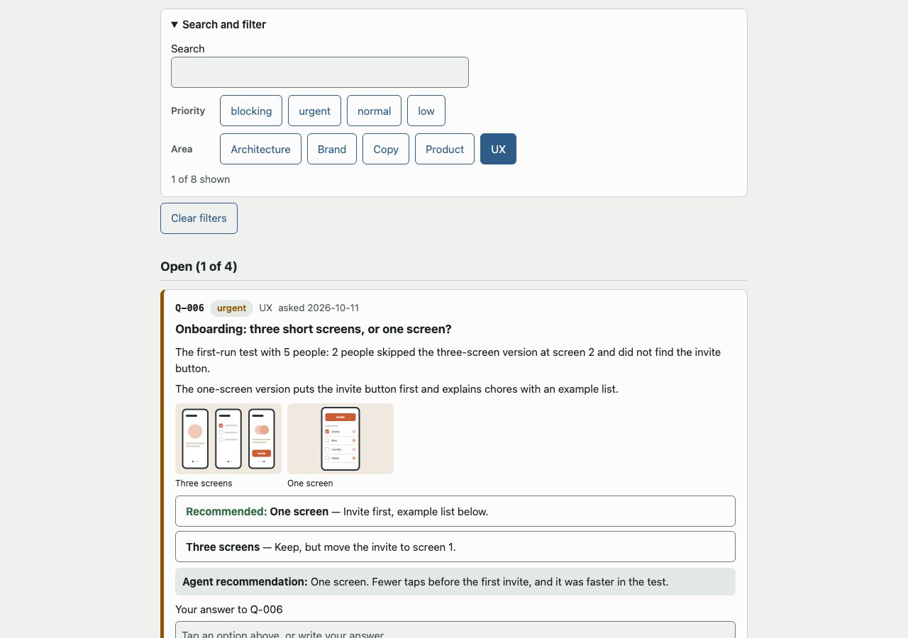
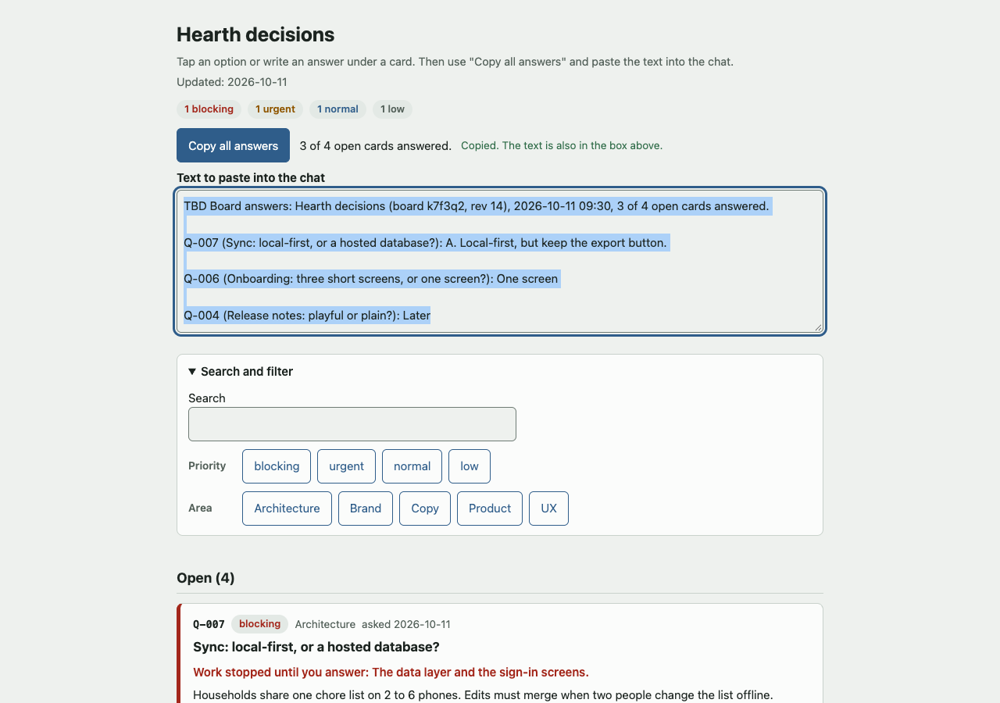

<p align="center">
  <picture>
    <source media="(prefers-color-scheme: dark)" srcset="docs/media/logo-dark.svg">
    
  </picture>
</p>

<h3 align="center">Don't be the meat blocker.</h3>
<p align="center">Answer what's needed from you, while the agents keep working.</p>

<p align="center">
  <a href="LICENSE"></a>
  <a href="https://agentskills.io"></a>
  <a href="CHANGELOG.md"></a>
  <a href="https://skills.sh/Camerash/tbd-board"></a>
</p>

<p align="center">
  
  &nbsp;
  
</p>

**TBD Board** gives your coding agent a calm way to ask you for decisions during long sessions, and keeps a record of every answer.

Your agent puts its questions on one page in your project. You open it in any browser, tap your answers, and paste them back into the chat in one go. The agent writes each decision to a log and keeps going. No server, no account, nothing to install for you.

## Why

Long agent sessions hit questions that only you should answer: what the product does, how it looks, what it costs, what's risky, what's hard to undo. Asking in the chat works when you're watching. When you're not, the agent either stops and waits, or guesses. Neither is great.

TBD Board takes the middle road. The agent writes each question as a card, with the context, the options, and its recommendation, and carries on with everything that doesn't depend on the answer. You answer when it suits you, in a batch. The agent gets all your decisions in one message, plans once, and moves on.

And because every answer lands in an add-only decision log, you can always see what was decided, when, and why. The small calls the agent made on its own are listed too, so you can scan them and overrule any of them by ID.

## How it works



1. **The board** is a single HTML file in your project. It works from your disk, offline, in light and dark mode, and on your phone.
2. **Cards** have the context, 2 to 4 options, the agent's pick and why, optional images, and a priority: blocking, urgent, normal, or low. A blocking card only pauses the work that depends on it.
3. **You answer** by tapping an option, writing a few words, or pressing *Decide later*. Then *Copy all answers*, and paste.
4. **The decision log** (`docs/decisions/log.md`) gets one entry per answer. Past entries are never edited. A new decision supersedes an old one, with a link.
5. **Decided for you** lists the small technical choices the agent made alone, with the reason. Reply with an ID (say `A-013: use the other one`) to change one.

The paste looks like this, so the agent knows exactly which board and which version you answered:

```text
TBD Board answers: Hearth decisions (board k7f3q2, rev 14), 2026-10-11 14:05, 3 of 4 open cards answered.

Q-007 (Sync: local-first, or a hosted database?): A. Local-first, but keep the export button.

Q-006 (Onboarding: three short screens, or one screen?): One screen.

Q-004 (Release notes: playful or plain?): Later
```

## Install

Pick **one** route per agent. Two routes install the skill two times.

| Agent | Install | Tested |
| --- | --- | --- |
| **Claude Code** | `claude plugin marketplace add Camerash/tbd-board`<br>`claude plugin install tbd-board@camerash`<br>(or `/plugin marketplace add ...` and `/plugin install ...` in a session) | Installs; [details](docs/install-tests.md) |
| **Codex** | `codex plugin marketplace add Camerash/tbd-board`<br>`codex plugin add tbd-board@camerash` | Yes |
| **GitHub Copilot CLI** | `copilot plugin marketplace add Camerash/tbd-board`<br>`copilot plugin install tbd-board@camerash` | Not yet |
| **VS Code (Copilot)** | Command Palette, **Chat: Install Plugin From Source**, then `https://github.com/Camerash/tbd-board` | Not yet |
| **Cursor** | `npx skills add Camerash/tbd-board -a cursor` | Not yet |
| **Gemini CLI** | `gemini skills install https://github.com/Camerash/tbd-board.git --path skills/tbd-board` | Not yet |

<details>
<summary><strong>More agents</strong></summary>

| Agent | Install | Tested |
| --- | --- | --- |
| Antigravity CLI | `agy plugin install https://github.com/Camerash/tbd-board` | Not yet |
| Windsurf | `npx skills add Camerash/tbd-board -a windsurf` | Not yet |
| OpenCode | `npx skills add Camerash/tbd-board -a opencode` | Not yet |
| Amp | `npx skills add Camerash/tbd-board -a amp` | Not yet |
| Goose | `npx skills add Camerash/tbd-board -a goose` | Not yet |
| Roo Code | `npx skills add Camerash/tbd-board -a roo` | Not yet |
| Kiro | `npx skills add Camerash/tbd-board -a kiro-cli` | Not yet |
| Pi | `pi install git:github.com/Camerash/tbd-board` | Not yet |
| Cline | Copy `skills/tbd-board` into `.cline/skills/` in your project | Not yet |

</details>

**Any other agent that reads Agent Skills:** `npx skills add Camerash/tbd-board` (we tested this route with Codex).

**An agent with no skill support:** copy the `skills/tbd-board` folder into your project and add this line to your `AGENTS.md`:

```markdown
For decisions that need the user, read and follow `skills/tbd-board/SKILL.md`.
```

The helper script needs Python 3.8 or newer, which most machines and agent sandboxes already have. No packages.

## Quick start

1. Install the skill for your agent (above).
2. Ask your agent: **"Set up a TBD board for this project."** It creates `docs/decisions/board.html` and `docs/decisions/log.md`.
3. Work as usual. When the agent adds cards, it tells you in the chat. Open the board, answer, press **Copy all answers**, and paste.

Want to see it first? Open [`examples/hearth/board.html`](examples/hearth/board.html), a demo board for a made-up chores app.

## Features

**Tap an option to answer.** The label drops into your answer, and you can add a few words after it ("A, but keep the export button").

<p align="center"></p>

**Search and filter.** One search box and chips for priority and area. The board remembers your filters.

<p align="center"></p>

**Copy all answers.** One block, with a header that names the board and its revision, ready to paste. If your clipboard is blocked, the text is right there to select.

<p align="center"></p>

And also:

- **Progress at a glance:** "3 of 4 open cards answered. 1 blocking card has no answer."
- **Decide later**, which is not the same as no answer: the agent keeps that card open.
- **Drafts** stay in your browser between visits, per board.
- **Light and dark**, readable contrast, big touch targets, keyboard friendly, and fine at 360 px wide.
- **Images on cards** for visual choices (mockups, icons, screenshots).
- **A careful helper** (`board.py`) that writes the board and the log together, checks for mistakes, and never breaks the page.

## FAQ

<details>
<summary><strong>Why copy and paste, and not a server or an inbox?</strong></summary>

We looked at about fifteen ways that tools bring human answers back to an agent: local servers that write a result file, blocking tool calls, hooks, harness inboxes, and hosted stores. They're clever, and several work really well inside their own setup.

Copy and paste is the one that works everywhere: every agent, every browser, a phone, offline, with no port, token, or background process. You decide when the batch is ready, and the paste is both the signal and the content. A file changing on disk doesn't wake up a chat agent anyway, so you'd still have to say "done". The header line lets the agent spot answers to an old version of the board, and a card you didn't answer simply stays open: the agent never fills in its own recommendation for you.

</details>

<details>
<summary><strong>Does it work offline?</strong></summary>

Yes. The board is one file with no external requests: no fonts, no CDN, no analytics. Open it straight from your disk.

</details>

<details>
<summary><strong>Can I use it on my phone?</strong></summary>

Yes, the page is built for it. The catch is getting the file onto your phone: iOS may not run the page's script when you open an HTML file from the Files app. Open it from a web address instead:

- **On your local network:** in the board folder, run `python3 -m http.server 8000`, then open `http://<your computer's IP>:8000/board.html` on your phone. This shares **everything in that folder** with your network, so stop it when you're done.
- **On a private web page:** put the file on any private static host you trust.

Answering works the same: copy on the phone, paste into any chat that reaches your agent.

</details>

<details>
<summary><strong>Where are my drafts?</strong></summary>

In your browser's local storage, on your device only, under a key that includes the board's ID (so two projects never mix). When a card is answered or closed, its draft is removed. In a private window, or with storage blocked, the board still works: drafts just aren't kept.

</details>

<details>
<summary><strong>Can I use my own decision log?</strong></summary>

Yes. If your project already has one, the agent uses it instead of making a second one (`board.py init --log ../DECISIONS.md`). New entries are added at the end, one line each, and your existing entries are never touched.

</details>

<details>
<summary><strong>How do I upgrade the board?</strong></summary>

Update the skill (for example `claude plugin update tbd-board@camerash`), then ask your agent to "upgrade the TBD board". It runs `board.py upgrade`, which swaps in the new page and keeps your data exactly as it was.

</details>

<details>
<summary><strong>How is this different from similar tools?</strong></summary>

There are some nice projects in this space:

- [ie3jp/decision-board](https://github.com/ie3jp/decision-board) builds a similar decision page as a Claude Artifact.
- Agent Docket is a hosted decision board for agents.
- [LangChain Agent Inbox](https://github.com/langchain-ai/agent-inbox) is an inbox UI for LangGraph interrupts.
- Matt Pocock's [`to-questionnaire`](https://github.com/mattpocock/skills) skill writes a Markdown questionnaire.
- Built-in tools such as Claude Code's `AskUserQuestion` ask a few questions and wait for the answer.

TBD Board's angle: one file with no server and no account, that works offline and on a phone; answers in a batch with one paste; an add-only decision log with supersede links; a visible list of the choices the agent made alone; and one skill for all common agents.

</details>

## Contributing

Issues and pull requests are welcome. See [CONTRIBUTING.md](CONTRIBUTING.md) for how to run the tests and regenerate the screenshots.

## License and credits

[MIT](LICENSE) © 2026 Esmond Wong.

The repository layout follows [mattpocock/skills](https://github.com/mattpocock/skills). The icon, the demo images, and the screenshots were made with coding agents and the tools in [`tools/`](tools/). Hearth, the demo app, is fictional.
